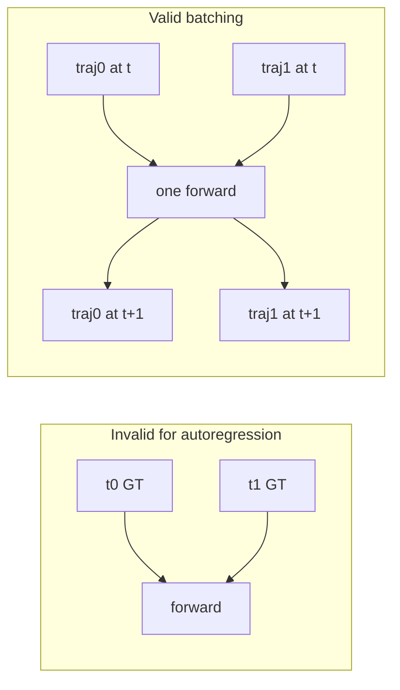

# Batched rollout: what works and what does not

## Simple answer to “can I do that?”

**Not the way the quote describes it, if “that” means correct autoregression along a single trajectory.**

PyG’s `DataLoader` with `batch_size > 1` on a **single-trajectory** `Subset` stacks **consecutive time steps** into one `Batch`. In `[do_rollout](src/gnn/training/rollout.py)`, one loop iteration then does **one** `model(input_graph)` and one `integrate_acceleration` for that whole `Batch`. The second graph in the batch is still the **ground-truth** graph at t{+}1; it does **not** use the integrated prediction from the first graph at t. So you are **not** running “parallel time” correctly—you are mis-conditioning every timestep after the first in the batch.

**There is no small fix** (e.g. only changing `[_build_next_graph](src/gnn/training/rollout.py)` or `[build_features](src/gnn/preprocessing/build_features.py)`) that makes **multiple consecutive timesteps of the same trajectory** in one forward autoregressively correct, because the dependency is strictly s_{t+1} = f(s_t) with s_t from the **previous prediction**, not from the next GT sample in the loader.

**What you can do instead (valid batching):** batch **different trajectories at the same time index** t. Then each graph in the `Batch` has its **own** state; there is no cross-trajectory time dependency, only parallel forwards. That preserves autoregression **per trajectory** while using wider GPU batches.

---

## Are `build_features` / `normalizer` the blocker?

**Usually no**, for trajectory-parallel batching: they are **per-node** (and edge builder uses `edge_index`). PyG `Batch` concatenates nodes and offsets `edge_index`; `[normalizer](src/gnn/preprocessing/normalizer.py)` typically normalizes flat `(num_nodes, F)` tensors, which matches batched graphs **if** each trajectory uses the **same mesh topology** (same `N`, same edges). If different `.pt` files had different meshes, batched rollout would need extra design (not assumed here).

---

## Implementation direction (if you pursue it)

Changes are **not** “flip `rollout_batch_size`”; they are a **new rollout driver** (or a guarded mode):

1. `**[rollout.py](src/gnn/training/rollout.py)`**
  - Add something like `do_rollout_batched_trajectories(model, dataset, traj_indices, batch_traj, ...)` that, for `t = 0 .. T_max-1`, builds a `Batch` from the **current** `input_graph` per trajectory (initialized from GT at t=0), runs `model`, integrates, `_build_next_graph` **per graph**, then `Batch.from_data_list` for the next t.  
  - **Variable lengths:** either roll until `min(lengths)` or track `active` masks and skip finished trajs when collating.  
  - `**[NewmarkDiscretizer](src/gnn/mesh_numerical_helpers/time_discretizer.py)`:** `_a_prev` must stay aligned with the **batched node layout** (same total nodes each step for a fixed set of trajs). `reset()` once per eval wave; each step updates `_a_prev` with shape matching concatenated `a_new`.
2. `**[trainer.py](src/gnn/training/trainer.py)`**
  - `[on_test_epoch_end](src/gnn/training/trainer.py)` and `[_compute_per_trajectory_noroll_metrics](src/gnn/training/trainer.py)` today loop **one trajectory at a time**. You would either:  
    - call the new batched rollout in chunks of `K` trajectories, then **split** `true_rollout` / `pred_rollout` back into per-traj lists for `[in_depth_plots](src/gnn/training/trainer.py)` and existing metrics, or  
    - keep single-traj API for plotting only and use batched path only for a fast metric pass.
  - `[_get_trajectory_loader](src/gnn/training/trainer.py)` stays for `rollout_batch_size=1`; optional new helper for multi-traj collation.
3. `**[train.py](src/gnn/train.py)`**
  - No change strictly required unless you add a new YAML flag (e.g. `rollout_trajectory_batch_size`) and plumb it into `LitModule`; `train.py` does not build rollout loaders today.
4. **Config**
  - Prefer a **new** name (e.g. `rollout_trajectory_batch_size`) so it is not confused with the current `rollout_batch_size` (timesteps per loader step on one traj). Default `1` preserves current behavior.
5. **Tests / sanity**
  - For a small split, compare metrics from **serial** vs **batched-trajectory** rollout (should match within float noise) before trusting speedups.

---

## Recommendation

- Keep `**rollout_batch_size: 1`** for the existing single-trajectory loader semantics.  
- If you need GPU utilization during rollout, plan for **trajectory-parallel** batching as above, not “more consecutive timesteps in one `Batch`.”

